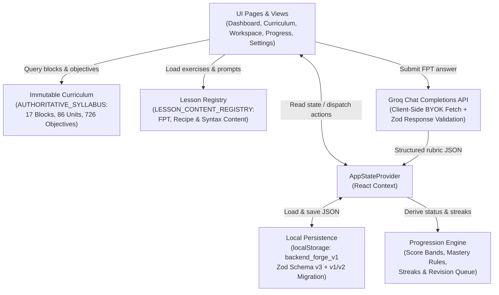

# Backend Forge

A local-first, interactive backend engineering learning platform built around **First Principles Thinking (FPT)**, **Recipe Mode**, and **Syntax Mode**. Backend Forge pairs an authoritative 17-block, 86-unit backend engineering syllabus with structured exercises, study streak tracking, and optional AI rubric evaluation powered by Groq.

## Features

- **Structured 17-Block Curriculum**: Covers 86 sub-blocks and 726 learning objectives spanning TypeScript fundamentals, OS/Node.js internals, networking, SQL and database concurrency, security, distributed systems, cloud operations, and AI-native backend engineering.
- **Three Complementary Learning Modes**:
  - **First Principles Thinking (FPT)**: Reason from system constraints, memory/network trade-offs, and invariants with multi-tier hints, reference explanations, and open-ended conceptual prompts.
  - **Recipe Mode**: Work through repeatable implementation blueprints, architectural decision sequences, edge-case guards, and production verification checks.
  - **Syntax Mode**: Practice idiomatic implementation code, SQL queries, schemas, and protocol primitives.
- **Optional AI Rubric Evaluation (BYOK via Groq)**: Grade FPT responses directly from the browser against a 100-point, 5-criterion engineering rubric using your own Groq API key—or study completely offline with manual progression.
- **Progress, Streaks & Revision Queue**: Tracks unit completion, mastery scores, misconceptions, focused study time via a built-in study timer, and an 18-week local-timezone activity heatmap.
- **Local-First Persistence & JSON Backups**: Stores state in browser `localStorage` (`backend_forge_v1`) with Zod-validated schema migrations, versioned JSON export/import (excluding API keys), and progress-only reset.
- **Responsive Dark & Light UI**: Desktop sidebar and mobile bottom navigation across five views—Dashboard, Curriculum, Learning Workspace, Progress, and Settings.

## Architecture & Technical Details

Backend Forge is a client-side single-page application that separates immutable curriculum data from mutable learner state, deterministic progression logic, and optional external AI evaluation:



### Key Implementation Details

- **Zod-Validated State & Migrations (`src/persistence/`)**: All persisted state is validated against `persistedAppStateSchema` (`CURRENT_SCHEMA_VERSION = 3`). On load, `loadAppState()` automatically migrates legacy v1 and v2 payloads without data loss. Versioned JSON backups (`exportAppStateJson` / `importAppStateJson`) validate every `subBlockId` against `AUTHORITATIVE_SYLLABUS` before applying and explicitly exclude `groqApiKey`.
- **Direct Client-Side AI Evaluation (`src/evaluation/groqEvaluator.ts`)**: When a Groq key is configured, FPT submissions call `https://api.groq.com/openai/v1/chat/completions` with `temperature: 0.2` and `response_format: { type: 'json_object' }` (and `reasoning_effort: 'low'` for `openai/gpt-oss*` models). Responses strip `<think>` blocks, extract JSON safely, and validate against `structuredEvaluationSchema` before updating progress.
- **Deterministic Progression (`src/progress/progression.ts`)**: Unit status (`not_started`, `in_progress`, `completed`, `needs_review`, `mastered`, `skipped`) is derived deterministically from required learning modes and evaluation scores (`>= 70` completes a unit, `>= 80` masters it, and spaced revision becomes due after 3–5 days without blocking completion progress).
- **Theme Bootstrapping (`index.html`)**: An inline script in `<head>` reads `backend_forge_v1` from `localStorage` before first paint to apply the `dark` class without flash-of-unstylized-theme.

## Curriculum Overview

The syllabus (`src/curriculum/`) is immutable and organized into 17 progressive blocks (`Blocks 0–16`), with full lesson content registered for all 86 sub-blocks in `src/content/registry.ts`:

| Block | Title |
| :--- | :--- |
| Block 0 | TypeScript for Backend Engineering |
| Block 1 | Operating Systems and Node.js Runtime |
| Block 2 | Networking and HTTP Internals |
| Block 3 | Node.js Server and API Architecture |
| Block 4 | Relational Databases and SQL |
| Block 5 | Database Internals, Transactions and Concurrency |
| Block 6 | Authentication, Authorization and Security |
| Block 7 | Backend Architecture and Code Organization |
| Block 8 | Testing, CI/CD and Shipping Your First Product |
| Block 9 | Asynchronous Processing and Background Jobs |
| Block 10 | Caching and Redis Architecture |
| Block 11 | Real-Time Systems and Messaging |
| Block 12 | Performance, Observability and Reliability |
| Block 13 | Distributed Systems and Advanced System Design |
| Block 14 | Cloud Infrastructure and Advanced Operations |
| Block 15 | Open Source and Large-Codebase Engineering |
| Block 16 | AI-Native Backend and Agentic Engineering |

## Evaluation Rubric & Mastery Rules

When AI evaluation is enabled, FPT responses are scored out of 100 across five weighted criteria (`src/evaluation/rubric.ts`) and classified into deterministic progression bands (`src/progress/progression.ts`):

| Criterion | Weight | Focus |
| :--- | :---: | :--- |
| Conceptual accuracy | 30 | Correctness of runtime, OS, network, and protocol claims |
| Causal reasoning and derivation | 25 | Explaining why a design emerges from underlying constraints |
| Completeness of mental model | 20 | Coverage of essential steps, invariants, and interactions |
| Edge cases and trade-offs | 15 | Recognition of failure modes, boundaries, and trade-offs |
| Clarity | 10 | Structured, unambiguous engineering communication |

- **0–49**: Rebuild understanding (flagged for immediate review)
- **50–69**: Targeted follow-up (`needs_review`)
- **70–79**: Completed (`completed` once all required modes finish; spaced revision scheduled after 3 days)
- **80–100**: Mastery-eligible (`mastered` once all required modes finish; spaced retention revision scheduled after 5 days)

## Tech Stack

- **Framework**: React 19, TypeScript, Vite 8
- **Styling**: Tailwind CSS v4 (`@tailwindcss/vite`), Lucide React, Motion
- **Validation & Content**: Zod v4, `react-markdown`, `remark-gfm`
- **AI Evaluation (Client-Side)**: Groq Chat Completions API (`llama-3.3-70b-versatile`, `openai/gpt-oss-120b`, `openai/gpt-oss-20b`, `llama-3.1-8b-instant`, `mixtral-8x7b-32768`)
- **Package Manager / Lockfile**: Bun (`bun.lock`) or npm

## Getting Started

### Prerequisites

- [Bun](https://bun.sh/) (recommended, matching `bun.lock`) or [Node.js](https://nodejs.org/) (v20+)

### Installation & Local Development

1. Clone the repository:

```bash
git clone https://github.com/Zayn329/Backendforge.git
cd Backendforge
```

2. Install dependencies:

```bash
bun install
```

3. Start the development server (runs on `http://localhost:3000`):

```bash
bun run dev
```

### Available Scripts

| Command | Description |
| :--- | :--- |
| `bun run dev` | Starts Vite dev server on port `3000` (`--host=0.0.0.0`) |
| `bun run build` | Builds the production bundle into `dist/` |
| `bun run preview` | Previews the production build locally |
| `bun run lint` | Runs TypeScript type-checking (`tsc --noEmit`) |
| `bun run clean` | Removes `dist` and `server.js` |

*(If using `npm`, replace `bun run` with `npm run`.)*

## Configuration

### Groq API Key (Optional)

Backend Forge works offline out of the box. To enable AI rubric grading:

1. Open **Settings** in the app.
2. Paste your Groq API key (`gsk_...`) under **AI Configuration (Groq)** and choose an evaluation model.
3. Click **Test Connection** to verify.

Your API key is stored solely in browser `localStorage` and is automatically stripped from exported JSON progress backups.

### Environment Variables

An `.env.example` file is included for AI Studio hosting metadata (`GEMINI_API_KEY`, `APP_URL`), though the client application itself runs fully in the browser without requiring server-side environment variables for local study.

## Project Structure

```text
Backendforge/
├── index.html                  # App entry HTML, fonts, and initial theme bootstrap
├── metadata.json               # Platform metadata
├── package.json                # Dependencies and Vite/TypeScript scripts
├── vite.config.ts              # Vite + React + Tailwind v4 configuration
├── public/assets/aistudio/     # Authoritative syllabus source text
└── src/
    ├── App.tsx                 # Section router and state provider
    ├── components/             # AppShell, Mode views, Heatmap, StudyTimerWidget, Panel
    ├── content/                # Modular lesson content for Blocks 0–16 (registry.ts)
    ├── curriculum/             # Authoritative 17-block syllabus & filtering helpers
    ├── evaluation/             # Groq API evaluator, Zod response schema, FPT rubric
    ├── learning/               # FPT, Recipe, and Syntax methodology definitions
    ├── pages/                  # Dashboard, Curriculum, Workspace, Progress, Settings
    ├── persistence/            # React context, Zod state schema (v3), localStorage I/O
    ├── progress/               # Streak calculation, mastery rules, revision queue
    ├── settings/               # Theme helpers
    ├── types/                  # Shared TypeScript interfaces
    └── utilities/              # Date formatting and className helpers
```
